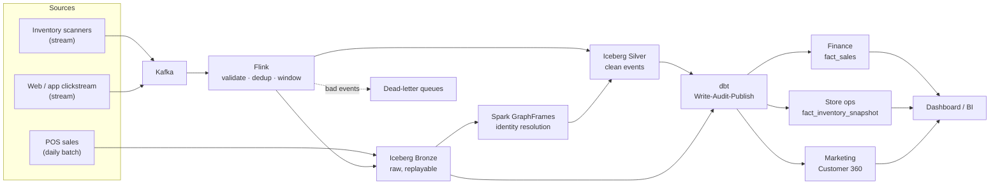
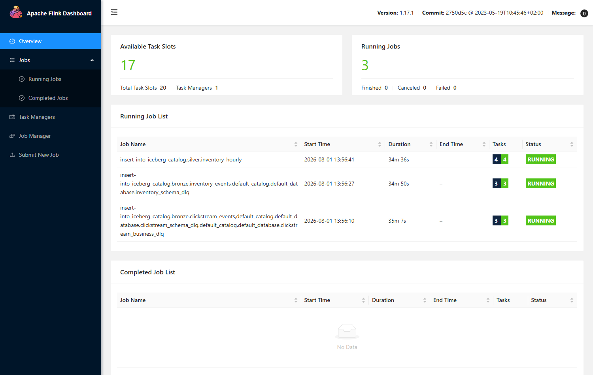
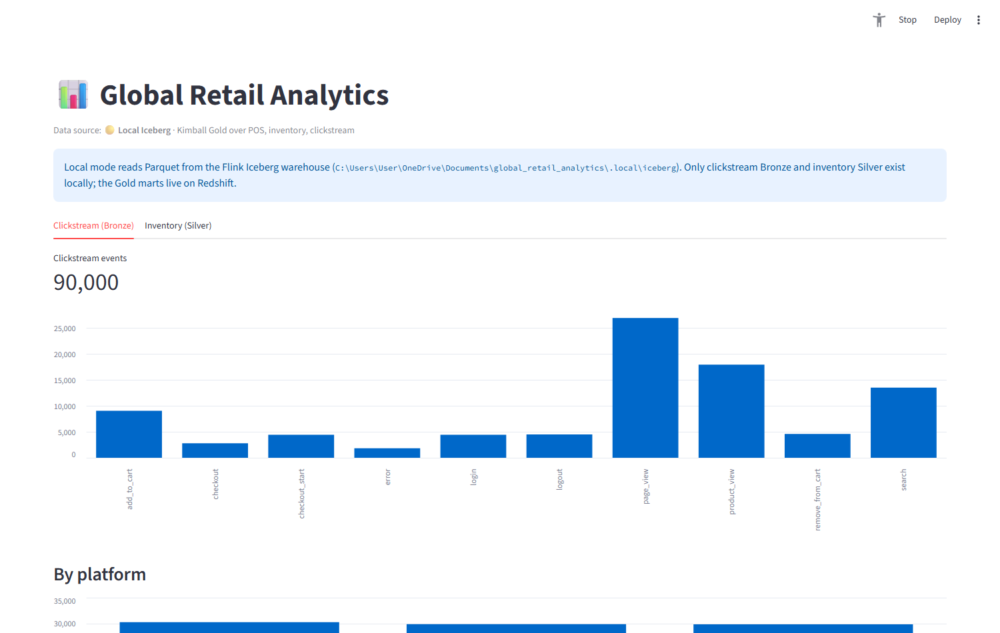
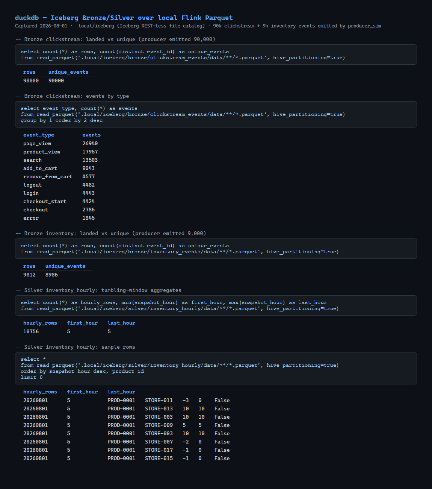
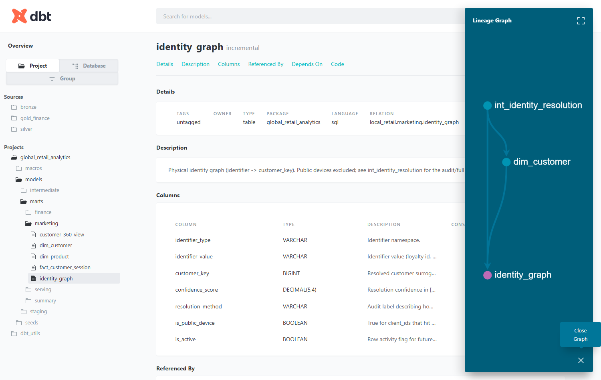

[](https://github.com/jerry98s/global_retail_analytics/actions/workflows/ci.yml)

# Global Retail Analytics Platform

One data platform that gives a retailer's finance, store-operations, and
marketing teams the data each of them needs, at the speed each of them needs
it, from three sources: store POS sales, inventory scanner events, and website
/ app clickstream.

**Stack:** Kafka · Flink · Spark GraphFrames · Iceberg · dbt · Redshift ·
Airflow · Great Expectations · Terraform · Streamlit

## The problem it solves

| Team | What they need | What the platform delivers |
|---|---|---|
| **Finance** | Sales figures that reconcile to the till, every day | `finance.fact_sales`: one row per POS line item, built daily and only published after automated checks pass |
| **Store operations** | Current stock per product and store | `finance.fact_inventory_snapshot`: hourly stock on hand from the scanner stream, corrected by the full event history once each hour closes |
| **Marketing** | One view of each customer across loyalty card, web and app, respecting consent | `serving.customer_360_serving`: identities merged by a graph algorithm, with personal data shown only where `marketing_consent` is given |
| **Engineering** | Recoverable data and visible failures | Raw events kept in a replayable lake, bad events routed to dead-letter queues, a runbook for every incident |

Each team gets its own latency and its own guarantees, instead of one
database trying to serve all three.

## The critical flow



1. **Ingest.** POS lands as daily Parquet files. Inventory and clickstream
   events stream through Kafka.
2. **Land and clean.** Flink stores every event in the Iceberg lake (Bronze),
   rejects malformed events to dead-letter queues, and aggregates inventory
   into hourly windows (Silver).
3. **Resolve identity.** Spark links loyalty IDs, web sessions and app devices
   into one customer, and excludes shared public devices from merges.
4. **Model and publish.** dbt builds Kimball star-schema marts into a staging
   copy, runs data-quality checks, and only then swaps them live
   (Write-Audit-Publish), so dashboards never see a half-built table.
5. **Serve.** Streamlit and BI tools read the published marts.

Airflow schedules the batch, identity, modelling and quality steps and manages
the Flink jobs; Terraform defines all the AWS infrastructure.

## Verified results

From the latest full end-to-end run (2026-08-31, fresh environment; raw output
in [docs/evidence](./docs/evidence/README.md)):

| Stage | Result |
|---|---|
| Streaming ingestion | 40,990 clickstream + 9,001 inventory events landed in Iceberg, 0 lost, 0 dead-lettered |
| Finance batch | 1,453 POS line items → 1,453 `fact_sales` rows (exact 1:1) |
| Identity resolution | 19,633 identifiers resolved to customers by Spark GraphFrames |
| Modelling | 18/18 dbt models built through Write-Audit-Publish; dbt tests gate every publish |
| Data quality | Current unit, dbt and Great Expectations results are in the [CI runs](https://github.com/jerry98s/global_retail_analytics/actions) for each commit |
| Customer 360 | 3,431 consent-gated customer rows served |

| | |
|:---:|:---:|
|  |  |
|  |  |

Screenshots are from the earlier 2026-08-01 run. Offline tests prove code
quality; they do not claim a production AWS deployment or a measured
10k events/s load test.

## Key design decisions

| Decision | Why | Record |
|---|---|---|
| Iceberg for the lake | Open format, snapshots for replay and time travel | [ADR-001](./docs/decisions/ADR-001-table-format.md) |
| Stream inventory, batch finance | Ops needs fresh stock; finance needs reconciled totals | [ADR-002](./docs/decisions/ADR-002-batch-vs-stream.md), [ADR-012](./docs/decisions/ADR-012-inventory-lambda.md) |
| Flink for streaming, Spark for the identity graph | Flink for stateful event-time processing; Spark GraphFrames for connected components | [ADR-006](./docs/decisions/ADR-006-flink-vs-spark.md), [ADR-010](./docs/decisions/ADR-010-spark-graphframes-identity.md) |
| Redshift Serverless for Gold | Pay-per-use warehouse with Spectrum over the lake | [ADR-005](./docs/decisions/ADR-005-warehouse-redshift.md) |
| Write-Audit-Publish | Consumers only ever see audited data | [ADR-009](./docs/decisions/ADR-009-write-audit-publish.md) |
| Semantic layer for metrics | One metric definition for the dashboard and analysts; on-hand is semi-additive | [ADR-013](./docs/decisions/ADR-013-semantic-layer.md) |

All decisions: [docs/decisions](./docs/decisions/). Cost figures in
[ADR-004](./docs/decisions/ADR-004-cost-model.md) are planning scenarios, not
observed bills.

## Run it

**Offline checks (same as CI, no Docker or AWS):**

```powershell
uv sync --group dev
.\.venv\Scripts\python.exe -m pytest tests/unit/ -q -m unit
```

**Full platform on this branch** (Docker Desktop, no AWS account):

```powershell
uv sync --group dev
.\scripts\local\run_local_stack.ps1 -Task all
```

Flink UI: <http://localhost:8082> · optional dashboard: <http://localhost:8501>

The AWS deploy (Terraform, MSK, EMR, Redshift, MWAA) is on `main` and is not
in this checkout.

| Branch | Role |
|---|---|
| `showcase` | This branch: the critical flow on a laptop |
| `main` | Cloud implementation |
| `local-testing-version` | Same local pipeline, plus the cloud tree |

## Repo map

| Path | What's there |
|---|---|
| `ingestion/` | Event contracts (JSON Schema), Kafka producers, POS batch generator |
| `streaming/` | Flink jobs and their config |
| `spark/` | GraphFrames identity-resolution job |
| `transformation/` | dbt project (staging → intermediate → marts) and Redshift DDL |
| `orchestration/` | Airflow DAGs |
| `quality/` | Great Expectations Silver event contract checks |
| `infra/` | Docker images for Kafka, Flink, and Spark |
| `scripts/` | One-command local runner |
| `dashboard/` | Streamlit app |
| `docs/` | Architecture decisions, data model, runbooks, evidence |

## Going deeper

- Architecture: [ARCHITECTURE.md](./ARCHITECTURE.md)
- Data model and ERD: [dimensional-model.md](./docs/data-model/dimensional-model.md), [erd.md](./docs/data-model/erd.md)
- Identity resolution: [identity-resolution.md](./docs/data-model/identity-resolution.md)
- Environments: [ENVIRONMENTS.md](./docs/ENVIRONMENTS.md)
- Operations: [docs/runbooks](./docs/runbooks/)

## License

[MIT](./LICENSE)
