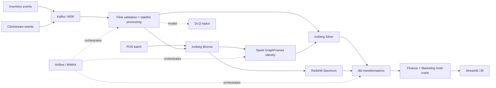

[](https://github.com/jerry98s/global_retail_analytics/actions/workflows/ci.yml)

# Global Retail Analytics Platform

A data platform for a retailer's finance, store-operations and marketing
teams, built from three sources: daily POS sales, a live inventory-scanner
stream, and web/app clickstream. Each team gets its own latency and its own
guarantees: reconciled daily sales, hourly stock on hand, and a consent-gated
Customer 360.

**Status: cloud-deployable and locally verified.** The whole pipeline runs end
to end on a laptop (Docker Kafka, Flink and Spark, DuckDB for the warehouse).
The AWS version is fully coded in Terraform and validated in CI, but no
completed cloud run is recorded yet. [What is and isn't proven](#what-is-not-proven-yet)
is spelled out below.

**Stack:** Kafka · Flink · Spark GraphFrames · Iceberg · Redshift · dbt · Airflow · Great
Expectations · Terraform · Streamlit

| At a glance | |
|---|---|
| Pipeline | 3 sources → Kafka → Flink → Iceberg Bronze/Silver → Spark identity graph → dbt Gold → dashboard |
| Modelling | 25 dbt models, Kimball star schema, SCD Type 2 on `dim_product`, MetricFlow semantic layer |
| Governance | Write-Audit-Publish: Gold is built in a staging copy, audited by dbt tests, then published in one transaction |
| Orchestration | 6 Airflow DAGs, one owner per Gold table, SNS alerts and timeouts on every task |
| Infrastructure | Terraform modules for S3, MSK, EMR, Redshift Serverless, MWAA, App Runner |
| Testing | 388 unit tests, DuckDB integration tests, Spark GraphFrames parity test, Airflow DagBag load, 9 CI jobs |
| Documentation | 13 architecture decision records, 6 runbooks, dated evidence ledger |

## Verified end-to-end

From the latest full local run (2026-08-31, fresh volumes — raw evidence in
[docs/evidence](./docs/evidence/README.md)):

| Stage | Result |
|---|---|
| Streaming ingestion | 40,990 clickstream + 9,001 inventory events → **landed in Iceberg Bronze** (0 lost, 0 DLQ) |
| Batch | 1,453 POS line items → 1,453 `finance.fact_sales` rows (exact 1:1) |
| Spark identity | GraphFrames connected components (Docker Spark) → **19,633 identifier→identity rows** in `silver.identity_resolution` |
| Transformation | **18/18 dbt models built** via Write-Audit-Publish (pending → audit → publish); dbt tests gate every publish |
| Data quality | Current unit, dbt and Great Expectations results are in the [CI runs](https://github.com/jerry98s/global_retail_analytics/actions) for each commit |
| Identity / C360 | Consent-gated Customer 360: **3,431 rows** in `customer_360_view` / `customer_360_serving` |

| | |
|:---:|:---:|
|  |  |
|  |  |

Screenshots captured from the earlier 2026-08-01 run (pre-ADR-010).

Latest regression run (2026-10-24, local Iceberg data loaded into a scratch
DuckDB): two consecutive Write-Audit-Publish rounds each built 23 models,
passed 158 dbt audit tests and published 10 Gold tables; the second round left
every Gold row count unchanged, so reruns are idempotent.

## What is not proven yet

Stated plainly so the claims above can be trusted:

- **No completed AWS run.** Terraform validates and CI checks the cloud wiring,
  but the [evidence ledger](./docs/evidence/README.md#cloud-execution-evidence)
  has no recorded cloud deployment yet.
- **No load test.** The producer's 10,000 events/s setting is a target; the
  [benchmark table](./docs/evidence/README.md#throughput-benchmark-protocol)
  is empty until a repeatable run fills it.
- **Costs are estimates.** [ADR-004](./docs/decisions/ADR-004-cost-model.md)
  is a planning model, not an observed bill.
- **Simulated data.** Volumes come from the bundled event generators, not a
  real retailer.

## Problems found by testing

Reviewing and running the pipeline surfaced bugs that unit tests alone missed.
Each fix landed with a test or a reproduction:

| Problem | How it showed up | Fix |
|---|---|---|
| Consent model never finished | An `OR` across two join keys forced a nested-loop join, about 9 billion comparisons on local data; the audit hung | Two equi-joins with `UNION ALL`: same rows (checked on a sample), view builds in 0.17 s |
| Long sessions truncated | A DuckDB scenario: an incremental run stored a session as 14:00–17:00 with 10 events; a full refresh gave 12:20–17:00 with 15 | Incremental window re-reads every client with a session still open |
| Flink jobs ignored their config on EMR | YARN application mode does not pass the step's environment to the JobManager | The submit script forwards every variable the config reads, and fails if a required one is missing |
| EMR steps could not be submitted from Windows | PowerShell 5.1 strips quotes from JSON arguments; reproduced against the real AWS CLI | Step definitions go through a file in the CLI's own format |
| Checkpoints expired after 14 days | A blanket S3 lifecycle rule would delete files that incremental RocksDB checkpoints still reference | Only scratch data and old versions expire |

## Branches

| Branch | Role |
|---|---|
| **`main`** | Cloud-deployable AWS implementation (MSK, EMR, Redshift, MWAA); execution evidence is tracked separately. |
| **`local-testing-version`** | Local Docker Kafka/Flink + DuckDB testing and demos. |

Local-only compose bind-mounts and short Flink windows stay on
`local-testing-version`. Shared cloud logic is cherry-picked to `main` when
needed — see [docs/ENVIRONMENTS.md](./docs/ENVIRONMENTS.md).

## The problem

Retail teams need different guarantees from the same platform:

- Finance needs reconciled daily sales facts.
- Store operations needs fresh inventory snapshots.
- Marketing needs consent-aware identity resolution, sessions, and RFM scores.
- Engineers need replayable raw data, visible failures, and recovery procedures.

The design separates those workloads instead of forcing them into one database
or one latency target.

## What this demonstrates

| Capability | Evidence in the repository |
|---|---|
| Streaming ingestion | Kafka producers + PyFlink jobs (event-time, checkpoints, dedup, DLQ) |
| Lakehouse | Iceberg Bronze/Silver, partition contracts, compaction / snapshot expiry |
| Analytics engineering | dbt staging → intermediate → finance/marketing marts |
| Dimensional modelling | Kimball facts/dims; SCD Type 2 only on `dim_product` |
| Identity / C360 | Spark GraphFrames connected components (ADR-010), public-device exclusion, consent gate |
| Data quality | JSON Schema contracts, dbt tests (Gold gate), Great Expectations (Silver events), pytest |
| Orchestration | Six Airflow DAGs (batch, C360, Flink, SCD2, GE, Iceberg maintenance) |
| Infrastructure | Terraform: S3, MSK, EMR, Redshift Serverless, MWAA, App Runner |
| Operations | ADRs + runbooks (replay, backfill, DLQ, consent, Kafka, Flink, Iceberg) |
| Governed Gold | Write-Audit-Publish (ADR-009): clone → audit → atomic publish |

## Architecture overview



Full design: [ARCHITECTURE.md](./ARCHITECTURE.md).

## Quick start

### Offline checks (matches CI)

Works on either branch. Prefer the project venv:

```powershell
uv sync --group dev
.\.venv\Scripts\python.exe -m pytest tests/unit/ -q -m unit
.\.venv\Scripts\python.exe -m ruff check ingestion streaming scripts quality orchestration spark tests
```

CI also runs Terraform fmt/validate, a Spark GraphFrames parity smoke test
(real `spark-submit` against the reference rules), the identity seed-fixture
drift check, DuckDB identity-chain dbt + `verify_local_identity.py`, and
compose config checks — see
[`.github/workflows/ci.yml`](./.github/workflows/ci.yml).

### Full local platform (`local-testing-version`)

Prerequisites: Docker Desktop, PowerShell, [uv](https://docs.astral.sh/uv/).

```powershell
git checkout local-testing-version
uv sync --group dev

.\scripts\local\run_local_stack.ps1 -Task all
```

- Kafka from the host: **`127.0.0.1:9092`** (not `localhost` on Docker Desktop).
- Flink UI: <http://localhost:8082> · Streamlit (optional): <http://localhost:8501>

<details><summary>Step by step, dbt source modes, and the optional local dashboard</summary>

```powershell
.\scripts\local\run_local_stack.ps1 -Task up
.\scripts\local\run_local_stack.ps1 -Task topics
.\scripts\local\run_local_stack.ps1 -Task flink
.\scripts\local\run_local_stack.ps1 -Task simulate
.\scripts\local\run_local_stack.ps1 -Task pos-parquet
.\scripts\local\run_local_stack.ps1 -Task spark
.\scripts\local\run_local_stack.ps1 -Task dbt          # -DbtSource iceberg (default)
.\scripts\local\run_local_stack.ps1 -Task quality
```

| Mode | Flag | What dbt reads |
|---|---|---|
| Fidelity (default) | `-DbtSource iceberg` | Flink Parquet under `.local/iceberg` + local POS Parquet; seeds only `dim_date` / `dim_store` |
| Fixture (CI identity) | `-DbtSource seeds` | Curated CSV under `seeds/bronze` (clickstream + pos identity scenarios) + `seeds/finance` reference dims + generated `seeds/silver/identity_resolution` (Spark fixture, CI drift-checked) |

```powershell
docker compose -f infra/docker/compose/docker-compose.yml `
  -f infra/docker/compose/docker-compose.dashboard.yml up -d --build dashboard
```

</details>

The runner copies `profiles.yml.example` → ignored `profiles.yml` and uses
DuckDB — no Redshift credentials required.

## Repo structure

| Path | Purpose |
|---|---|
| `ingestion/` | Schemas, Kafka topics/producers, POS Parquet generator |
| `streaming/` | Flink jobs + YAML config |
| `spark/` | GraphFrames identity-resolution job + deterministic reference rules |
| `transformation/` | dbt project + Redshift DDL / Spectrum / serving views |
| `orchestration/` | Airflow DAGs + plugins |
| `quality/` | Great Expectations Silver event contract checks |
| `tests/` | Offline unit + DuckDB integration tests |
| `metadata/` | Governed object + metric catalog (YAML) for `metadata.meta.*` |
| `infra/` | Docker Compose, Flink + Spark images, Terraform, EMR bootstrap |
| `scripts/local/` | Local stack runner (Iceberg→DuckDB loader and GE runner live on `local-testing-version`) |
| `scripts/cloud/` | Terraform wrapper, deploy, Redshift bootstrap, MSK producers |
| `scripts/common/` | Shared helpers (`metadata_observer.py`, fail-open run metadata) |
| `dashboard/` | Streamlit (local Iceberg or Redshift) |
| `docs/` | Architecture, ADRs, data model, runbooks, evidence |

## Key design decisions

| ADR | Topic |
|---|---|
| [ADR-001](./docs/decisions/ADR-001-table-format.md) | Why Iceberg |
| [ADR-002](./docs/decisions/ADR-002-batch-vs-stream.md) | Batch vs streaming boundaries |
| [ADR-003](./docs/decisions/ADR-003-identity-graph.md) | Customer identity graph |
| [ADR-004](./docs/decisions/ADR-004-cost-model.md) | Illustrative cost model |
| [ADR-005](./docs/decisions/ADR-005-warehouse-redshift.md) | Why Redshift Serverless |
| [ADR-006](./docs/decisions/ADR-006-flink-vs-spark.md) | Why Flink vs Spark Streaming |
| [ADR-007](./docs/decisions/ADR-007-inventory-kappa.md) | Inventory kappa path (superseded in part by ADR-012) |
| [ADR-008](./docs/decisions/ADR-008-metadata-database.md) | Operational metadata DB |
| [ADR-009](./docs/decisions/ADR-009-write-audit-publish.md) | Write-Audit-Publish for Gold |
| [ADR-010](./docs/decisions/ADR-010-spark-graphframes-identity.md) | Spark GraphFrames for identity resolution |
| [ADR-011](./docs/decisions/ADR-011-replayable-bronze.md) | Replayable raw Bronze, Spark canonical Silver |
| [ADR-012](./docs/decisions/ADR-012-inventory-lambda.md) | Inventory lambda: Spark owns covered hours |
| [ADR-013](./docs/decisions/ADR-013-semantic-layer.md) | dbt Semantic Layer (MetricFlow) for metrics |

Cost figures are planning scenarios, not observed cloud bills.

## Environments and deploy

Cloud Bronze keeps raw Kafka bytes and transport metadata; Spark validates and
deduplicates into Silver. Before upgrading an existing deployment, follow the
[cloud rollout/replay guide](docs/runbooks/bronze-replay.md).

| Flavour | Branch / where | Entry point |
|---|---|---|
| Local | `local-testing-version` | `scripts/local/run_local_stack.ps1` |
| Cloud dev/prod | `main` | `scripts/cloud/run_cloud_stack.ps1` (wraps `run_terraform.ps1` + `deploy_platform.ps1` + `bootstrap_redshift.ps1` + `run_msk_producers.ps1`) |

Local is the reproducible path: one command, no AWS account, no bill. Cloud is
fully coded in Terraform behind a single wrapper script, and is designed to be
stood up for a run and destroyed afterwards rather than left idle. Deploys are
manual by design — CI validates every push, but no workflow applies Terraform
or touches an AWS account.

On a fresh clone, fill in your own account-specific config first (all four are
gitignored — only the `*.example` templates ship in the repo):

```powershell
cd infra\terraform\bootstrap
copy terraform.tfvars.example terraform.tfvars      # state_bucket_name + budget_alert_email
cd ..\envs
copy dev.backend.hcl.example dev.backend.hcl        # bucket = your state bucket
copy dev.tfvars.example dev.tfvars                  # VPC, subnets, Redshift password
cd ..\..\..
```

```powershell
# Cloud infrastructure + streaming smoke (AWS account required).
# This does not execute Redshift SQL, POS, Spark, dbt, or GE.
.\scripts\cloud\run_cloud_stack.ps1 -Task all
.\scripts\cloud\run_cloud_stack.ps1 -Task spark          # after POS lands
.\scripts\cloud\run_cloud_stack.ps1 -Task deploy          # after code changes
.\scripts\cloud\run_cloud_stack.ps1 -Task verify          # post-deploy smoke checks
```

<details><summary>Prod apply and per-script flags (siblings of the wrapper)</summary>

```powershell
.\scripts\cloud\run_cloud_stack.ps1 -Task apply -Env prod -AutoApprove
.\scripts\cloud\run_terraform.ps1 -Stack bootstrap -Action apply
.\scripts\cloud\run_terraform.ps1 -Stack platform -Env dev -Action apply
.\scripts\cloud\deploy_platform.ps1 -Env dev
```

</details>

For the complete Bronze → Silver → Gold proof—including POS, Spark identity,
Redshift SQL, dbt, GE, evidence capture, and teardown—follow
`docs/runbooks/dev-cloud-test-run.md` on `main`.

With MWAA enabled (`enable_mwaa = true`):

- Set every Variable that `deploy_platform.ps1 -Action airflow-vars` lists,
  including `alert_topic_arn`. Task failures, freshness-SLA breaches and Gold
  row-count warnings publish to that SNS topic; set `alert_email` in tfvars to
  receive them. Without the Variable, tasks still fail but only their log says
  `ALERT NOT SENT`.
- MWAA installs `infra/terraform/modules/mwaa/requirements.txt` under the
  Airflow 2.8.1 constraints. dbt runs from a separate virtualenv that
  `startup.sh` builds from the hashed `dbt-requirements.txt` lock; a failed
  install shows in the startup-script log, and every dbt task then fails with
  `DBT_BIN ... is not executable`.
- Each staging/intermediate model is built by one DAG
  (`orchestration/airflow/plugins/dbt_selectors.py`). On a fresh warehouse,
  trigger `warehouse_daily_batch_pipeline` before the first marketing and
  catalog runs, so `stg_pos_transactions` and `stg_inventory_events` exist for
  RFM and the product catalog.
- Gold publish is blocked when an owned table cannot be read or shrinks by more
  than `row_count_delta_threshold` (default 0.20) against the last clean
  baseline. After a legitimate large deletion, update the
  `gold_row_counts_baseline` Variable and clear the task.

### Cost and teardown

`-Task all` creates billable AWS infrastructure — MSK, EMR, Redshift Serverless,
MWAA, and App Runner. Destroy the platform stack when a session is finished:

```powershell
.\scripts\cloud\run_terraform.ps1 -Stack platform -Env dev -Action destroy
```

The bootstrap stack (state bucket, lock table, budget alarm) is negligible and
can stay in place between sessions.

For a guided lowest-cost end-to-end run (no MWAA/dashboard, laptop-driven dbt
and GE, evidence capture, destroy checklist), follow
[docs/runbooks/dev-cloud-test-run.md](./docs/runbooks/dev-cloud-test-run.md).

Details: [ENVIRONMENTS.md](./docs/ENVIRONMENTS.md), [REDSHIFT.md](./docs/REDSHIFT.md),
[scripts/README.md](./scripts/README.md). Use `*.tfvars.example` /
`*.backend.hcl.example` / `profiles.yml.example` — do not commit real
credentials, account IDs, or VPC IDs.

## Local testing deep-dives

| Topic | Where |
|---|---|
| Iceberg Parquet queries | [local-data-queries.md](./docs/runbooks/local-data-queries.md), notebook `01_data_walkthrough` (on `local-testing-version`) |
| Spark identity (GraphFrames) | `.\scripts\local\run_local_stack.ps1 -Task spark` → Iceberg `silver.identity_resolution` + replace-only `consumer_current/` export for the DuckDB bridge |
| Identity scenarios (seeds) | `.\scripts\local\run_local_stack.ps1 -Task dbt -DbtSource seeds` then `python tests/integration/verify_local_identity.py` |
| Flink ops | [flink-operations.md](./docs/runbooks/flink-operations.md) |
| Evidence / benchmarks | [docs/evidence/README.md](./docs/evidence/README.md) |

Offline pytest + ruff prove static quality. They do **not** claim a completed
AWS production deployment or a measured 10k events/s load test.

## Data model

| Consumer | Product | Grain |
|---|---|---|
| Finance | `finance.fact_sales` | `(transaction_id, line_item_number)` |
| Ops | `finance.fact_inventory_snapshot` | product/store/hour |
| Marketing | `marketing.fact_customer_session` | `session_id` |
| Marketing | `marketing.dim_customer` | `customer_key` + RFM/consent |
| BI | `serving.customer_360_serving` | consent-gated Customer 360 |

- SCD Type 2 **only** on `dim_product`.
- Identity: deterministic graph; public devices excluded from C360 merges —
  [identity-resolution.md](./docs/data-model/identity-resolution.md).
- Full grains/ERD: [dimensional-model.md](./docs/data-model/dimensional-model.md).

## Suggested portfolio walkthrough

1. Start with the three business latency requirements.
2. Explain why inventory streams through Flink with Spark correcting closed hours, while finance remains batch.
3. Show one invalid event reaching a DLQ.
4. Walk through product SCD2 and identity-resolution tests.
5. Open the Streamlit dashboard and Flink checkpoint view.
6. Close with recovery procedures, cost assumptions, and known limits.

Verification is deliberately split between dated full E2E evidence and current
offline regression checks. See [docs/evidence](./docs/evidence/README.md) for
the exact commands, results, and limitations; the latest full local E2E run
(2026-08-31) includes the Spark GraphFrames identity step (ADR-010) end to end.

## License

[MIT](./LICENSE)
