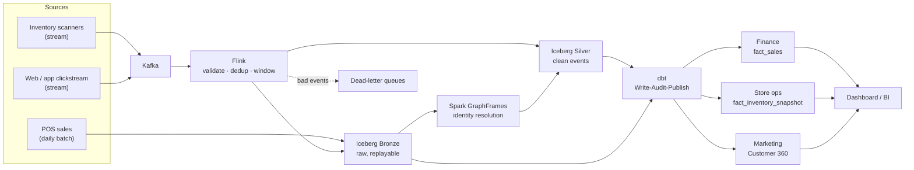
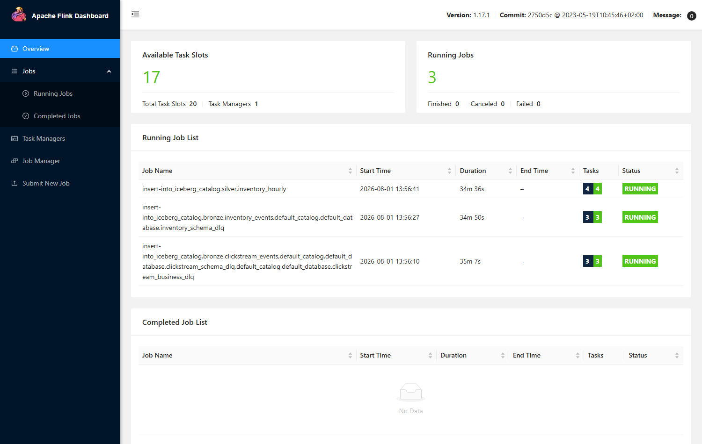
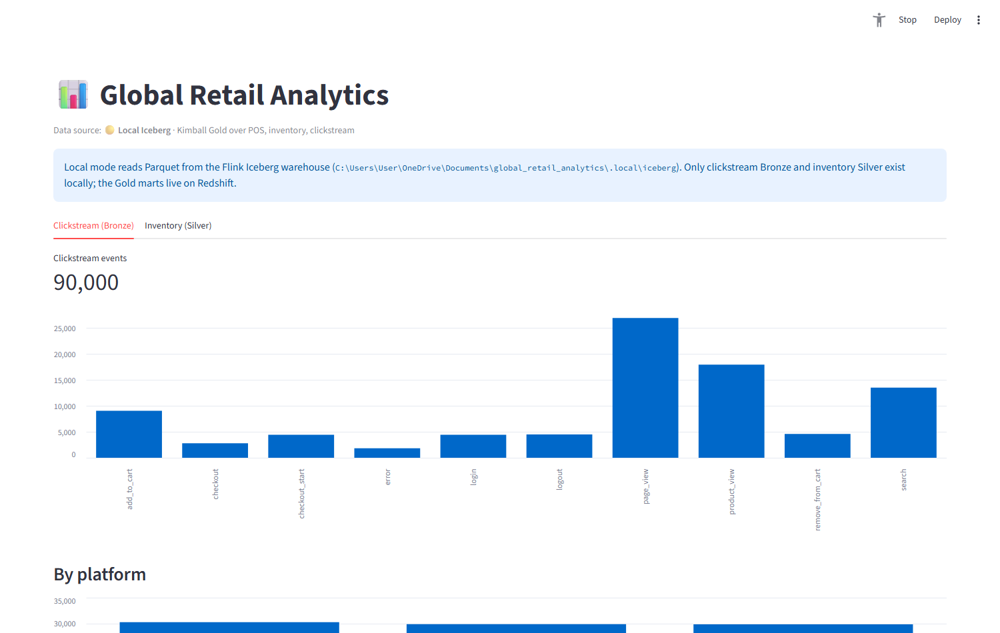
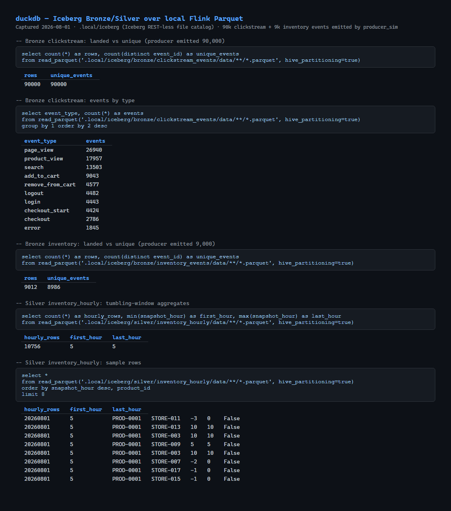
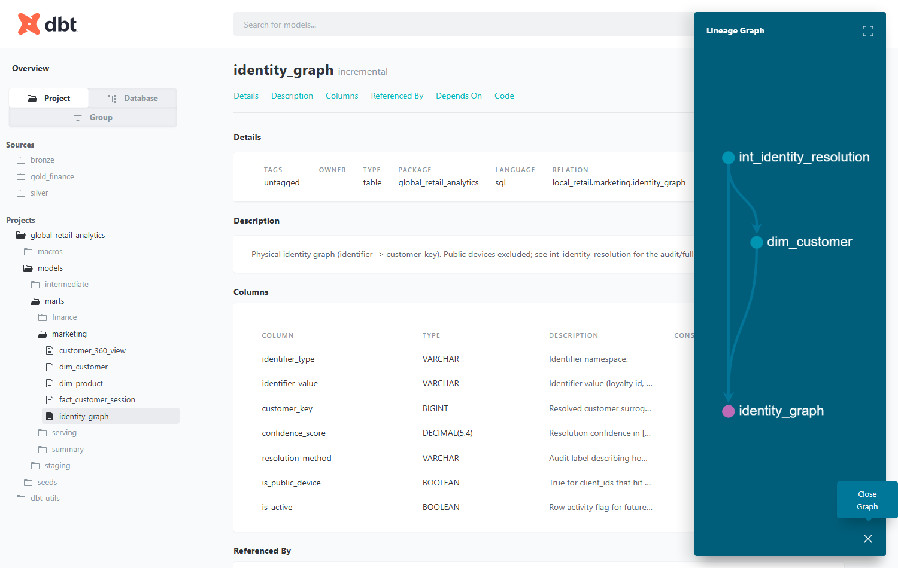

[](https://github.com/jerry98s/global_retail_analytics/actions/workflows/ci.yml)

# Global Retail Analytics Platform

One data platform that gives a retailer's finance, store-operations, and
marketing teams the data each of them needs, at the speed each of them needs
it, from three sources: store POS sales, inventory scanner events, and website
/ app clickstream.

**Stack:** Kafka · Flink · Spark GraphFrames · Iceberg · dbt · Redshift ·
Airflow · Great Expectations · Terraform · Streamlit

## The problem it solves

| Team | What they need | What the platform delivers |
|---|---|---|
| **Finance** | Sales figures that reconcile to the till, every day | `finance.fact_sales`: one row per POS line item, built daily and only published after automated checks pass |
| **Store operations** | Current stock per product and store | `serving.inventory_current_position`: that pair's last published balance, plus Flink hours after its own hour and outside Spark coverage (about an hour old); `finance.fact_inventory_snapshot` holds hourly history, corrected by the full event history once each hour closes |
| **Marketing** | One view of each customer across loyalty card, web and app, respecting consent | `serving.customer_360_serving`: identities merged by a graph algorithm, with personal data shown only where `marketing_consent` is given |
| **Engineering** | Recoverable data and visible failures | Raw events kept in a replayable lake, bad events routed to dead-letter queues, a runbook for every incident |

Each team gets its own latency and its own guarantees, instead of one
database trying to serve all three.

## The critical flow



1. **Ingest.** POS lands as daily Parquet files. Inventory and clickstream
   events stream through Kafka.
2. **Land and clean.** Flink stores every event in the Iceberg lake (Bronze),
   rejects malformed events to dead-letter queues, and aggregates inventory
   into hourly windows (Silver).
3. **Resolve identity.** Spark merges an online account with a loyalty card
   only when the account verified that card. Shared devices never merge
   customers; their sign-ins are kept as device-session associations. dbt
   builds one session per session instance and attributes it to a customer
   only when exactly one account signed in; other sessions stay anonymous.
   Consent comes only from explicit statements, and RFM value only from
   confirmed POS sales.
4. **Model and publish.** dbt builds Kimball star-schema marts into a staging
   copy, runs data-quality checks, and only then swaps them live
   (Write-Audit-Publish), so dashboards never see a half-built table.
5. **Serve.** Streamlit and BI tools read the published marts.

Airflow schedules the batch, identity, modelling and quality steps and manages
the Flink jobs; Terraform defines all the AWS infrastructure.

## Verified results

The last full local end-to-end run is 2026-08-31 (fresh environment; raw output
in [docs/evidence](./docs/evidence/README.md)). Its identity output includes
device-only rows the current graph no longer emits. Later ledger rows are
offline or partial checks, not a newer full run:

| Stage | Result |
|---|---|
| Streaming ingestion | 40,990 clickstream + 9,001 inventory events landed in Iceberg, 0 lost, 0 dead-lettered |
| Finance batch | 1,453 POS line items → 1,453 `fact_sales` rows (exact 1:1) |
| Identity resolution | 19,633 identifiers resolved to customers by Spark GraphFrames |
| Modelling | 18/18 dbt models built through Write-Audit-Publish; dbt tests gate every publish |
| Data quality | Current unit, dbt and Great Expectations results are in the [CI runs](https://github.com/jerry98s/global_retail_analytics/actions) for each commit |
| Customer 360 | 3,431 consent-gated customer × session rows (the serving view has since been rolled up to one row per customer) |

| | |
|:---:|:---:|
|  |  |
|  |  |

Screenshots are from the earlier 2026-08-01 run.

Latest regression run (2026-10-24, this branch's Iceberg output loaded into a
scratch DuckDB): two consecutive Write-Audit-Publish rounds each built 23
models, passed 158 dbt audit tests and published 10 Gold tables; the second
round left every Gold row count unchanged.

Not proven yet: no completed AWS run, no measured load test (10k events/s is
a target), and cost figures are estimates. The data comes from the bundled
simulators. Details in the [evidence ledger](./docs/evidence/README.md).

## Key design decisions

| Decision | Why | Record |
|---|---|---|
| Iceberg for the lake | Open format, snapshots for replay and time travel | [ADR-001](./docs/decisions/ADR-001-table-format.md) |
| Stream inventory, batch finance | Ops needs fresh stock; finance needs reconciled totals | [ADR-002](./docs/decisions/ADR-002-batch-vs-stream.md), [ADR-012](./docs/decisions/ADR-012-inventory-lambda.md) |
| Flink for streaming, Spark for the identity graph | Flink for stateful event-time processing; Spark GraphFrames for connected components | [ADR-006](./docs/decisions/ADR-006-flink-vs-spark.md), [ADR-010](./docs/decisions/ADR-010-spark-graphframes-identity.md) |
| Redshift Serverless for Gold | Pay-per-use warehouse with Spectrum over the lake | [ADR-005](./docs/decisions/ADR-005-warehouse-redshift.md) |
| Write-Audit-Publish | Consumers only ever see audited data | [ADR-009](./docs/decisions/ADR-009-write-audit-publish.md) |
| Semantic layer for metrics | One metric definition for the dashboard and analysts; on-hand is semi-additive | [ADR-013](./docs/decisions/ADR-013-semantic-layer.md) |

All decisions: [docs/decisions](./docs/decisions/). Cost figures in
[ADR-004](./docs/decisions/ADR-004-cost-model.md) are planning scenarios, not
observed bills.

## Run it

**Offline checks (same as CI, no Docker or AWS):**

```powershell
uv sync --group dev
.\.venv\Scripts\python.exe -m pytest tests/unit/ -q -m unit
```

**Full platform on this branch** (Docker Desktop, no AWS account):

```powershell
uv sync --group dev
.\scripts\local\run_local_stack.ps1 -Task all
```

To send the fixed Customer 360 journeys instead of random load (an anonymous
visit, a shared tablet, two accounts on one loyalty card, a consent opt-out, a
late event and a retry; the same `--anchor` resends the same bytes):

```powershell
.\.venv\Scripts\python.exe -m ingestion.kafka.producer_sim.clickstream_producer --scenario acceptance
```

After the next Spark and dbt run, check those journeys and the Customer 360
rules (consent, attribution, RFM, orders) against the published Gold tables.
Between `-Task dbt` and `-Task quality`, `--pending` checks the unpublished
copies instead:

```powershell
.\.venv\Scripts\python.exe tests/integration/verify_customer_360.py
```

To prove a rerun gives the same answer, `-Task replay` runs Spark and dbt
twice over the same Bronze, POS file and evaluation date, then compares a
fingerprint of the Spark exports, the Customer 360 models and every pending Gold
table. Run IDs and timestamps are excluded from the fingerprint. The replay
never publishes. Keep the producers idle, and start and finish it on the same
day, because the POS file is generated per date:

```powershell
.\scripts\local\run_local_stack.ps1 -Task replay
```

To watch an identity change move through the published graph, run the
propagation demo with Kafka and Flink already up. It publishes an account and
two cards as separate customers, then verifies the account to both cards and
checks that the account, its session and the higher card's purchase all move
onto the lower card. It runs once; those ids are outside the random ranges:

```powershell
.\.venv\Scripts\python.exe scripts/local/demo_identity_change.py
```

`-Task quality -Scope finance|marketing|catalog` tests and publishes one owning
DAG. A blocked marketing scope does not stop finance. The default, and
`-Task all`, still publish every scope. This demo breaks a copy of the
warehouse twice (a failing marketing test, then an unacknowledged shrink) and
publishes finance both times. The real warehouse is not changed:

```powershell
.\.venv\Scripts\python.exe scripts/local/demo_wap_isolation.py
```

Corrected POS days use the same contract as the warehouse DAG. Fix the Parquet
under `.local/iceberg/bronze/pos_transactions`, then pass the inclusive range
to both steps. A day whose corrected file has no lines must also be listed in
`-RestateEmptyDates`, or the audit blocks:

```powershell
.\scripts\local\run_local_stack.ps1 -Task dbt -RestateFrom 2026-10-10 -RestateTo 2026-10-11 -RestateEmptyDates 2026-10-11
.\scripts\local\run_local_stack.ps1 -Task quality -RestateFrom 2026-10-10 -RestateTo 2026-10-11 -RestateEmptyDates 2026-10-11
```

The Spark identity benchmark copies the current Bronze into `.local/benchmark`
at 1×, 5× and 10×, with ids remapped so the copies are different people. It
does not write the real lake, and it is not a streaming throughput result:

```powershell
.\.venv\Scripts\python.exe scripts/local/benchmark_identity.py
```

The dashboard Customer 360 tab reads two summary tables built from one Gold
fact each (`summary.consent_identity_daily` from sessions,
`summary.customer_segments` from customers) and shows four sections: session
analytics, customer segments, consent and identity, and pipeline reliability.
The reliability numbers (identity changes, quarantine rate, replay result,
freshness) come from the metadata store, not from Gold.

Flink UI: <http://localhost:8082> · optional dashboard: <http://localhost:8501>

The AWS deploy (Terraform, MSK, EMR, Redshift, MWAA) is on `main` and is not
in this checkout.

| Branch | Role |
|---|---|
| `local-testing-version` | This branch: the whole pipeline on a laptop |
| `main` | Default branch: the cloud implementation (Terraform, MSK, EMR, Redshift, MWAA) |

## Repo map

| Path | What's there |
|---|---|
| `ingestion/` | Event contracts (JSON Schema), Kafka producers, POS batch generator |
| `streaming/` | Flink jobs and their config |
| `spark/` | GraphFrames identity-resolution job |
| `transformation/` | dbt project (staging → intermediate → marts). Redshift DDL is on `main` |
| `orchestration/` | Airflow DAGs |
| `quality/` | Great Expectations Silver event contract checks |
| `infra/` | Docker images for Kafka, Flink, and Spark |
| `scripts/` | One-command local runner |
| `dashboard/` | Streamlit app |
| `docs/` | Architecture decisions, data model, runbooks, evidence |

## Going deeper

- Architecture: [ARCHITECTURE.md](./ARCHITECTURE.md)
- Data model and ERD: [dimensional-model.md](./docs/data-model/dimensional-model.md), [erd.md](./docs/data-model/erd.md)
- Identity resolution: [identity-resolution.md](./docs/data-model/identity-resolution.md)
- Environments: [ENVIRONMENTS.md](./docs/ENVIRONMENTS.md)
- Operations: [docs/runbooks](./docs/runbooks/)

## License

[MIT](./LICENSE)
